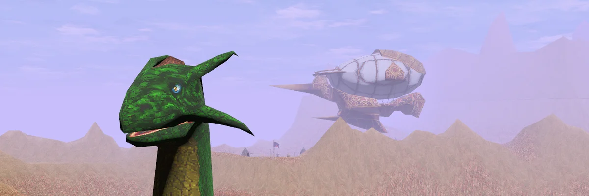

<div align="center">



# cyrus

**A faithful rebuild of *The Elder Scrolls Adventures: Redguard* in Rust and Bevy**

Bring your own GOG install. cyrus ships no game data.

[Setup](docs/SETUP.md) · [Roadmap](docs/ROADMAP.md) · [How cyrus is built](docs/METHOD.md) · [Contributing](CONTRIBUTING.md)

</div>

> [!IMPORTANT]
> cyrus is early in development. Startup presentation and world viewing work,
> but the game is not yet playable.

## What works today

- Play the installed splash and title, then browse the data-driven book menu.
- Play unlocked movies, edit persistent settings, and enter the starting world
  with New Game. Load currently starts the same fresh world; saves are pending.
- Load Redguard worlds from a local GOG install in the native or browser viewer.
- Inspect loaded worlds with a free camera.

See the [roadmap](docs/ROADMAP.md) for verified support and remaining work.

## Run cyrus

You need the GOG release of *The Elder Scrolls Adventures: Redguard*, Rust, and
`just`. Extract the game, then link its `Redguard` directory into this checkout:

```sh
ln -s /path/to/GOG/extracted/app/Redguard redguard
just run
```

Use `just run --scene START` to open a world directly. The
[setup guide](docs/SETUP.md) covers the browser build, the original game runner,
and all available commands.

The game install remains read-only. cyrus stores settings, caches, and
screenshots in the gitignored `cyrus-config/` directory.

## Faithful by default

Faithful mode aims to reproduce what the player experiences: visuals, audio,
controls, camera behavior, script and animation timing, and game outcomes.
Modern controls, camera behavior, and graphics remain opt-in settings.

Technical limits are not part of that goal. cyrus can use current hardware,
load faster, and run at a higher frame rate without changing game behavior.

File formats and engine documentation come from
[redguard-preservation](https://github.com/michidk/redguard-preservation).
cyrus publishes recovered format and engine facts through redguard-preservation.
No original code or game data is part of this repository.

## Acknowledgements

[RGUnity](https://github.com/RGUnity/redguard-unity) inspired cyrus and provided
foundational Redguard research used by this project. RGUnity is a human-developed
Unity reimplementation built without AI assistance. Its contributors focus on
meticulous fidelity and the small details that make the original game behave
correctly.

cyrus uses AI-assisted development to reach broad working coverage quickly. This
complements RGUnity's detail-first work. We are grateful to its contributors for
their research, implementation, and continued care for Redguard.

## Project documentation

- [How cyrus is built](docs/METHOD.md) explains how evidence and fidelity guide
  each change.
- [Setup](docs/SETUP.md) covers native, browser, and original-game runs.
- [Roadmap](docs/ROADMAP.md) tracks completed and planned game support.
- [Contributing](CONTRIBUTING.md) covers bug reports and pull requests.
- [Agent contract](AGENTS.md) defines the rules for coding agents.

Each crate also has its own `README.md`.

cyrus is written entirely by LLM coding agents (Codex and Claude Code), directed
and reviewed by the maintainer against the original game.

*cyrus is not affiliated with Bethesda Softworks.*
