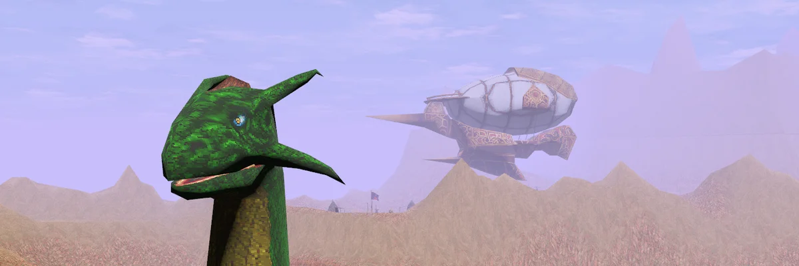
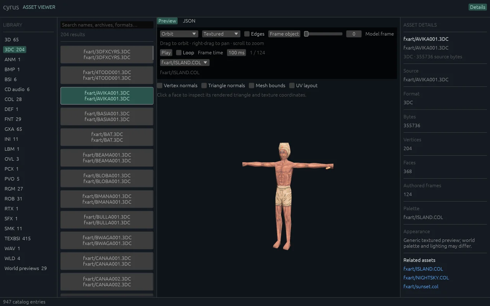
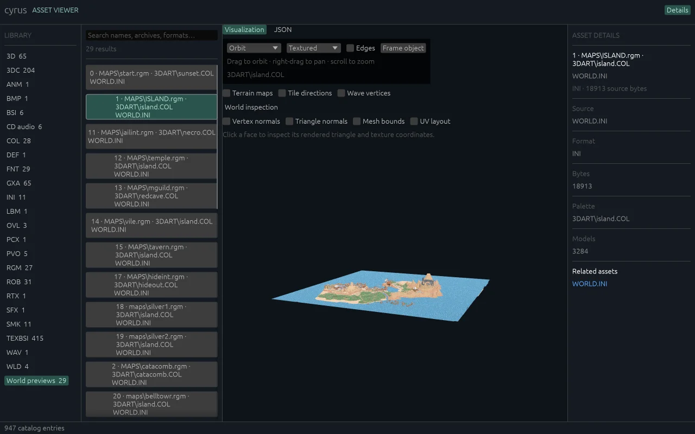
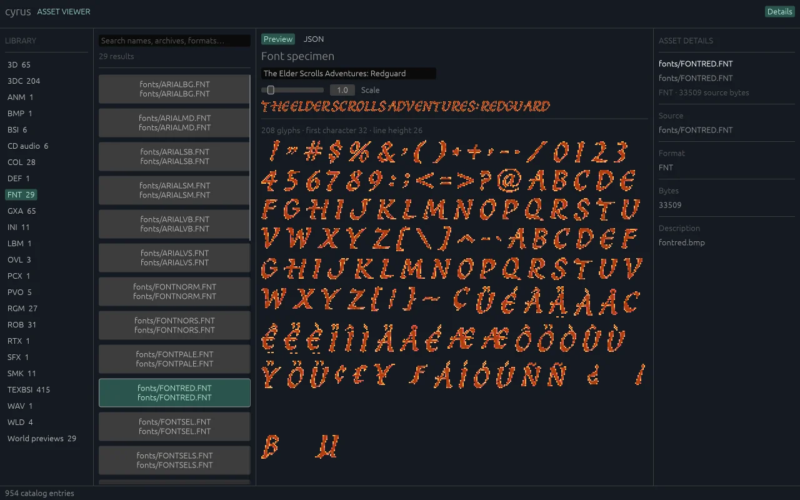

<div align="center">



# cyrus

**A faithful rebuild of *The Elder Scrolls Adventures: Redguard* in Rust and Bevy**

Bring your own GOG install. cyrus ships no game data.

[Playing and controls](docs/PLAYING.md) · [Setup](docs/SETUP.md) · [Delivery issues](https://github.com/michidk/cyrus/issues/92) · [How cyrus is built](docs/METHOD.md) · [Contributing](CONTRIBUTING.md)

</div>

> [!IMPORTANT]
> cyrus is early in development. You can start a new game, play in its worlds
> and save and resume, but a complete gameplay and fidelity playthrough has not
> been accepted.

| Watch cyrus v0.5.0 | Watch the cyrus editor |
| --- | --- |
| [](https://youtu.be/pG4tS6XbdIw) | [](https://youtu.be/B1s0oL_fFGU) |

## Name

cyrus is named after [Cyrus](https://en.uesp.net/wiki/Redguard:Cyrus), the main character of *Redguard*.

## What works today

- Play the installed splash and title, then browse the data-driven book menu.
- Play unlocked movies, edit persistent settings, and start New Game with its
  introduction.
- Move, fight and interact in Redguard's worlds with the implemented controls.
- Save and load cyrus sessions through the book, with gameplay thumbnails, in
  the native and browser builds.
- Jump to any world and inspect it with a free camera (Backtick menu).
- Browse every asset in the separate asset viewer.

See [Playing and controls](docs/PLAYING.md) for controls, saving and current
limitations. See the [delivery issues](https://github.com/michidk/cyrus/issues/92) for remaining work and acceptance evidence.

Join the [Discord](https://discord.com/invite/xjCCyqbxkp) and discuss cyrus in
`#redguard-cyrus-rust`.

## Run cyrus

You need the GOG release of *The Elder Scrolls Adventures: Redguard*, Rust, and
`just`. Extract the game, then provide its `Redguard` directory:

```sh
just run --install /path/to/GOG/extracted/app/Redguard
```

Without `--install`, both native applications use `REDGUARD_DIR`, a remembered
location, or the default local/GOG folders, including a `redguard` symlink in the
working directory. If no usable install is found, a window lets you enter a
folder or browse for it, and remembers it for both the game and viewer.
Prebuilt packages for Windows, Linux and macOS are on the
[releases page](https://github.com/michidk/cyrus/releases/latest); see
[Playing](docs/PLAYING.md#start).

Use `just run --scene START` to open a world directly. The
[setup guide](docs/SETUP.md) covers the browser build, the original game runner,
and all available commands.

The game install remains read-only. cyrus stores settings, saves, caches and
logs in `CYRUS_CONFIG_DIR` when that is set, else in an existing `game-config/`
folder in the directory you launch from, else in your user profile's standard
folders (on Linux `~/.config/cyrus`, `~/.cache/cyrus` and `~/.local/state/cyrus`).

## Web version

Open the [browser build](https://michidk.github.io/cyrus/game/) and click
**Choose game folder**. Select your main GOG folder, such as
`D:\Games\GOG Galaxy\Redguard`, containing both `DOSBOX` and the inner
`Redguard` folder. Files stay on your computer. Select the folder again after
reloading. The [browser guide](crates/cyrus-web/README.md) covers the bundled
game-file server, URL options and building from source.

## Asset viewer

cyrus ships a separate asset viewer for Redguard's files: models, worlds,
textures, fonts, animations, scripts, audio and movies. Download a
prebuilt `cyrus-viewer` archive from the
[latest release](https://github.com/michidk/cyrus/releases/latest) or open the
[browser viewer](https://michidk.github.io/cyrus/viewer/) directly. From source,
run `cargo run -p cyrus-viewer -- --install /path/to/Redguard`. See the
[viewer guide](crates/cyrus-viewer/README.md) for previews, controls, and browser
setup. The viewer uses a modern inspection interface and generic rendering.

| Model | World | Font |
| --- | --- | --- |
|  |  |  |

## Related projects

cyrus is two applications, the game and the asset viewer, and sits beside two other Redguard projects:

- [Redguard Preservation](https://github.com/michidk/redguard-preservation) ([docs](https://michidk.github.io/redguard-preservation/)): the file format, engine and configuration documentation cyrus is built from, and the `redguard-preservation` crate that parses the game's files.
- [Maiko](https://github.com/michidk/maiko) ([site](https://michidk.github.io/maiko/)): runs the original game natively on Windows and Linux, without DOSBox, by translating the original executable.

## Faithful by default

Faithful mode aims to reproduce what the player experiences: visuals, audio,
controls, camera behavior, script and animation timing, and game outcomes.
Modern mode is an opt-in setting that changes only graphics and sound; modern controls and camera
behavior come from the bundled `movement` mod.

Technical limits are not part of that goal. cyrus can use current hardware,
load faster, and run at a higher frame rate without changing game behavior.

File formats and engine documentation come from
[redguard-preservation](https://github.com/michidk/redguard-preservation).
cyrus publishes recovered format and engine facts through redguard-preservation.
No original code or game data is part of this repository.

## Acknowledgements

[RGUnity](https://github.com/RGUnity/redguard-unity) inspired cyrus and provided
foundational Redguard research used by this project. RGUnity is a human-developed
Unity reimplementation built without AI assistance. Its contributors focus on
meticulous fidelity and the small details that make the original game behave
correctly.

cyrus uses AI-assisted development to reach broad working coverage quickly. This
complements RGUnity's detail-first work. We are grateful to its contributors for
their research, implementation, and continued care for Redguard.

## Project documentation

- [How cyrus is built](docs/METHOD.md) explains how evidence and fidelity guide
  each change.
- [Setup](docs/SETUP.md) covers native, browser, and original-game runs.
- [Delivery issues](https://github.com/michidk/cyrus/issues/92) track remaining game support and acceptance.
- [Contributing](CONTRIBUTING.md) covers bug reports and pull requests.
- [Agent contract](AGENTS.md) defines the rules for coding agents.

Each crate also has its own `README.md`.

cyrus is written entirely by LLM coding agents (Codex and Claude Code), directed
and reviewed by the maintainer against the original game.

*cyrus is not affiliated with Bethesda Softworks.*
