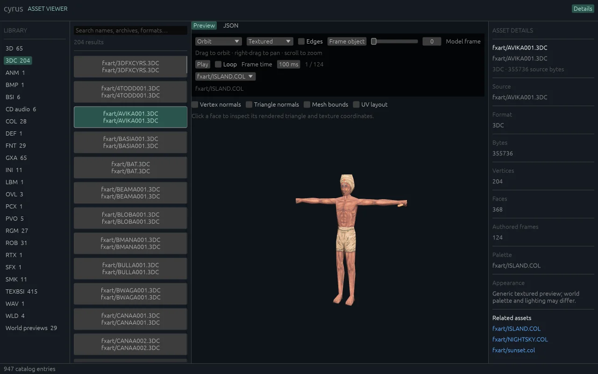
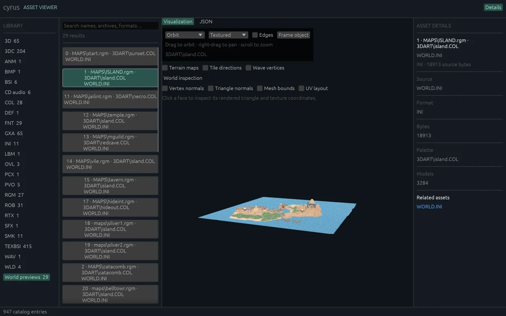
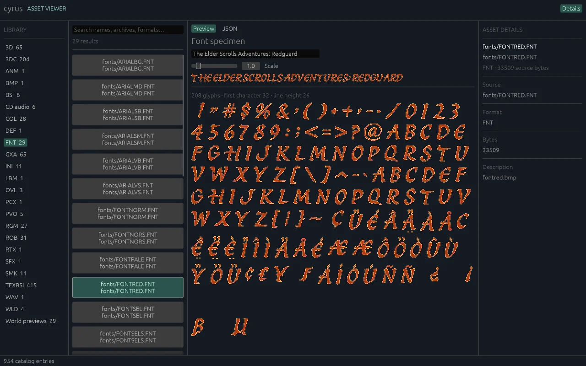

# cyrus-viewer

Browse Redguard models, worlds, textures, fonts, animations, scripts, and audio.
Bring your own [GOG copy](https://www.gog.com/en/game/the_elder_scrolls_adventures_redguard).
The viewer reads your install without changing it.

[Open in your browser](https://michidk.github.io/cyrus/viewer/) ·
[Download native builds](https://github.com/michidk/cyrus/releases/latest)

| Model | World | Font |
| --- | --- | --- |
|  |  |  |

## Get started

In the browser, click **Choose game folder** and select the outer GOG folder
containing `Redguard`, `DOSBOX`, `game.gog`, and `game.ins`. Files stay on your
computer; no upload or server is needed. Select the folder again after reloading.
Use `?install=local` to override a saved server URL.

For native builds, launch `cyrus-viewer` and choose your install, or pass it directly:

```sh
./cyrus-viewer --install /path/to/Redguard
# Windows: cyrus-viewer.exe --install C:\path\to\Redguard
```

The native viewer also checks `REDGUARD_DIR`, the remembered location, and default
local/GOG folders. Its picker accepts the outer GOG folder or inner game folder
and remembers the location for both viewer and game. Linux Browse needs a desktop
file portal or Zenity; entering a path works without either. The Linux archive
uses Ubuntu 24.04 system libraries.

## Explore

Choose a format, search by name or path, then select an item. Open archives to
browse their members. Up/Down changes selection outside text fields; drag panel
boundaries to resize them. Details and References link related assets.

| Preview | Tools |
| --- | --- |
| Images and fonts | Zoom, palettes, animation frames, glyph atlas |
| Models | Shading, animation, normals, bounds, face picking, UV layout |
| Worlds and terrain | Placements, navigation, heightmaps, materials, tile inspection |
| Audio and movies | Playback, seeking, looping, volume, movie audio tracks and frame stepping |
| Scripts and definitions | Readable source and decoded JSON |
| PVO spatial data | Wireframe octree, depth controls, slices, linked world objects |

Models and worlds use Orbit by default. Drag to rotate, right-drag to pan, and
scroll to zoom. In Flycam, right-drag to look and use WASD to move, Q/E to move
down/up, and Shift to move faster while the pointer is over the viewport.

Use the palette selector for associated world palettes. Without palette shows
grayscale indices when no embedded colors are available. JSON views expose decoded
records without pixel, compressed-frame, or PCM payloads. Unsupported or malformed
entries report a reason; unrecognized files are hidden.

Browser asset selections and model palettes are shareable through the address
bar. The recipient needs the same installation. Back restores the previous selection.

## Run from source

```sh
cargo run -p cyrus-viewer -- --install /path/to/Redguard
```

For a browser build with a local install server:

```sh
just viewer-web-build
just run-viewer-web --install /path/to/Redguard
```

For a prebuilt browser archive, run from its `browser/` directory with Python 3.11+:

```sh
python3 viewer-server.py --directory . --install /path/to/Redguard --port 8080
```

Open <http://127.0.0.1:8080/viewer.html>, expand the server option, and click
**Connect to server**. Here, `--install` points to the folder containing `RGFX.EXE`.
The server binds to loopback and serves original bytes; previews are generated
in browser memory. Keep game files and generated previews private and outside
source control or application releases.

| Native option | Browser parameter |
| --- | --- |
| `--install PATH` | `?install=URL` |
| `--asset ID` | `?asset=ID` or `#asset=ID` |
| `--file SOURCE` | Add `&file=SOURCE` to identify an archive |
| `--palette NAME` | Add `&palette=NAME` to select a model palette |

Percent-encode URL values. `file` and `palette` require `asset`.
See [setup](../../docs/SETUP.md) for shared build and install options.

## Limits and troubleshooting

The viewer uses generic inspection rendering. It does not claim Faithful game
lighting, timing, or scene behavior. Model playback steps converted frames at the
chosen interval; scripts are inspected as data and never executed.

Movies load their full original bytes and prepare audio before playback. Seeking
may pause while decoding catches up. Browser audio requires a user gesture.

After a parser update, close the native viewer and remove
`cyrus-config/cache/viewer/` to regenerate cached previews. For a custom cache
location, remove its `viewer/` subdirectory. Reload the updated browser app to
regenerate its in-memory previews.

Portable catalog contracts are tested in `cyrus-assets`. Rendering, input, and
media playback also need native and browser runtime checks.
